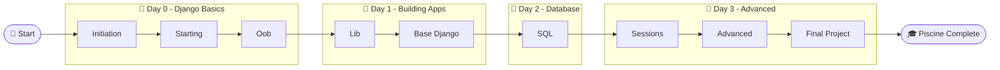

# Django Piscine - 42

> This repository contains my work for the **42 Django Piscine**.
> The goal of the Piscine is to learn the fundamentals of Django by completing a series of projects, where each one introduces new concepts and builds on the previous exercises.
## 🗺️ Piscine Structure

## Validation

Projects **must be validated in order**. You cannot register for the next project until the previous one has been successfully validated.

The required validation order is:

  

## Repository

Each project is organized in its own directory and contains the corresponding solution for that exercise. This repository serves as a record of my progress throughout the Django Piscine.
