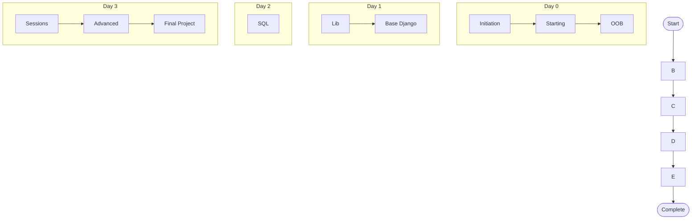

# Django Piscine 42

> This repository contains my work for the **42 Django Piscine**.
> The goal of the Piscine is to learn the fundamentals of Django by completing a series of projects, where each exercise introduces new concepts and builds on the previous one.

## Modules

The projects must be completed in the following order:

  

## Django Piscine Progress

## Repository Structure

Each project is organized in its own directory and contains the corresponding solution for that exercise.

This repository serves as a record of my progress throughout the Django Piscine.
